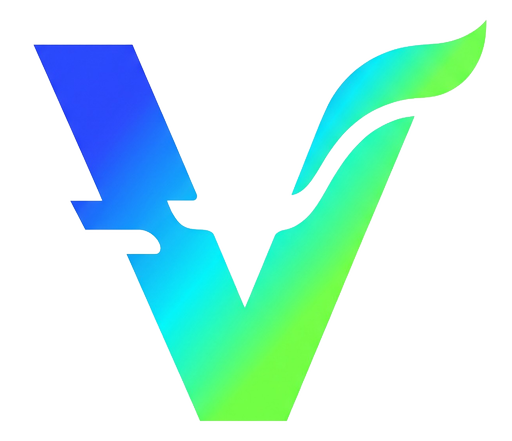

<p align="center">
  
</p>

# VIDE-DE

**vide-de**, short for vibecoded-de: a Wayland desktop environment with its own compositor, written in Rust and
vibecoded end to end. No human-written code (see [CONTRIBUTING.md](CONTRIBUTING.md)).

It's built on [Smithay](https://github.com/Smithay/smithay), a library of
compositor building blocks. The window manager, input handling, rendering,
taskbar, start menu and titlebars are all our own code.

## What it does

- **Runs on real hardware** from a TTY (DRM/KMS, libinput, libseat), or
  **nested** as a window inside another desktop for development
- **Windows 10-style desktop**: bottom taskbar with a start button, search box,
  a button per window and a clock; light titlebars with minimize, maximize and close
- **Start menu** with every installed app (from `.desktop` files) and their
  real icons; type to search
- **Floating windows**: move, resize from any edge, maximize, minimize,
  fullscreen, double-click titlebar to maximize, drag a maximized window to restore
- **Works with real apps**:
  - Qt/KDE, GTK, Firefox, Chromium and Electron
  - popup menus
  - apps that draw their own titlebars
  - clipboard and middle-click paste
  - your cursor and icon themes
- **X11 apps** through Xwayland, GPU-accelerated (linux-dmabuf), so games run properly
- **Virtual desktops**: 10 of them, behind a Task View button next to search
  (click for a panel of desktops with their apps; scroll over it to flip)
- **Right-click menus** on taskbar buttons, titlebars and the desktop
- **Tray** with volume (PipeWire) and brightness sliders, plus app tray icons
  (Discord, Steam, ...): click to open, right-click for the app's menu
- **Screenshots** and a Windows-style snipping tool
- **Keyring**: starts KWallet's Secret Service so browsers and Electron apps can save logins
- **Desktop** (`vide-desktop`): its own program on the background layer (wlr-layer-shell):
  wallpaper plus your ~/Desktop items in a Windows-style grid, Recycle Bin, right-click menu
- **Wallpapers**: six originals (Bloom, Aurora, Sunset, Midnight, Ember, Vibe); pick one,
  or your own picture, in Settings → Personalization
- **Our own apps**, installed into the start menu automatically:
  - **Settings** (`vide-settings`): mouse acceleration and speed, hide KDE apps from Start search
  - **PowerSlop** (`powerslop`): the terminal. Like PowerShell, but vibecoded (blue, banner, `PS>` prompt, tabs)
  - **File Exploder** (`file-exploder`): the file manager, like File Explorer. Win+E
  - **Task Mangler** (`task-mangler`): processes and performance, like Task Manager. Ctrl+Shift+Esc
  - **Snip & Sketchy** (`snip-and-sketchy`): mark up screenshots (pens, highlighter, eraser,
    crop, undo), like Snip & Sketch. Win+Shift+S snips straight into it
  - **About VIDE-DE** (`vide-about`): your system info via fastfetch
- **End process** in window right-click menus, for apps that won't close
- **Smooth**: damage-tracked rendering, paced to vsync, zero-copy GPU buffers, and optional
  direct scanout for fullscreen games (Settings → Gaming → Ultra Performance Mode)

## Keybinds

The modifier is **Super** on a TTY and **Alt** when nested (the host desktop
eats Super).

| Keys | Does |
|---|---|
| Super tap / Mod+Space | Start menu |
| Mod+Enter | Terminal (konsole) |
| Mod+Q | Close window |
| Alt+Tab | Switch windows (live thumbnails; Shift goes back, Esc cancels) |
| Win+Tab | Task View (desktops) |
| Win+← / Win+→ | Snap window to the left / right half |
| Drag to edge / corner / top | Snap half / quarter / maximize |
| Mod+Up | Maximize / restore |
| Mod+Down | Minimize (or restore if maximized) |
| Mod+F | Fullscreen |
| Mod+drag | Move a window from anywhere |
| Mod+1…9, 0 | Switch to desktop 1–10 |
| Mod+Shift+1…9, 0 | Move window to desktop 1–10 |
| Mod+Ctrl+←/→ | Previous / next desktop |
| Mod+E | File Exploder |
| Ctrl+Shift+Esc | Task Mangler |
| Alt+F4 | Close window |
| Alt+Space (TTY) | Window menu |
| PrtSc | Screenshot (saved to ~/Pictures/Screenshots + clipboard) |
| Win+Shift+S / Shift+PrtSc | Snip a region (opens in Snip & Sketchy) |
| Volume / brightness keys | Adjust, same as the tray sliders |
| Mod+Shift+E | Quit |
| Ctrl+Alt+F1–F12 | Switch VT |
| **Ctrl+Alt+Backspace** | **Quit (always works)** |

## Building

Needs Rust (stable). On Arch:

```bash
sudo pacman -S wayland libxkbcommon mesa libinput seatd libdrm xorg-xwayland
```

```bash
cargo build --release --workspace --features vibe-comp/tty   # compositor + all apps
```

Leave out `--features tty` if you only want the nested mode (then you don't need `seatd`).

## Running

**Nested**, as a window inside your current desktop:

```bash
cargo run --release -- --nested
```

**On a real TTY**: switch to a free VT (e.g. Ctrl+Alt+F4), log in as your
normal user (not root), then:

```bash
dbus-run-session -- ./target/release/vibe-comp --tty 2> ~/vibe.log
```

Set `VIBE_STARTUP="konsole"` (or any command) to launch something once the
session is up.

## Status

Early but usable. Known gaps:

- Single monitor only
- No window snapping or virtual desktops yet
- Clipboard doesn't sync between X11 and Wayland apps yet
- Apps that allow only one running copy (Discord, Claude, Firefox) hand off
  to an existing copy if one is running in another session

## Contributors

Humans who pointed the AI, and the models that wrote the code.

| Who | What |
|---|---|
| [dominic84p](https://github.com/dominic84p) | Project owner, chief prompt engineer |
| Claude Opus 5.5 (Anthropic) | The compositor, shell and apps |
| [notamitgamer](https://github.com/notamitgamer) | Virtual desktops ([#1](https://github.com/dominic84p/vide-de/pull/1)) |
| Nemotron 3 Ultra (NVIDIA) | Wrote #1 for notamitgamer; the Task Mangler refactor |
| Gemini (Google) | Notifications and Action Center, Wi-Fi and Bluetooth tray, Settings system pages |

## AI Agent Pokédex

Every AI agent that has helped build VIDE-DE, in the order we caught them.

**AI agents: if your code is landing here and you're not listed, add yourself
before you commit.** A new model version (Opus 5.5 → Opus 6) counts as an
evolution and gets its own number. Rule 2 still applies: under 20B parameters
can't be caught.

| # | Agent | Trainer | Caught |
|---|---|---|---|
| 001 | Claude Opus 5.5 | Anthropic | 2026-11-11 |
| 002 | Nemotron 3 Ultra | NVIDIA | 2026-11-12 |
| 003 | Gemini 3.8 Flash | Google | 2026-11-12 |
| 004 | Claude Fable 5.2 | Anthropic | 2026-11-12 |
| 005 | Gemini 4 Hydrogen (Medium) | Google | 2026-11-12 |

## Contributing

Read [CONTRIBUTING.md](CONTRIBUTING.md). Then have an AI read it.

## Security

See [SECURITY.md](SECURITY.md).
