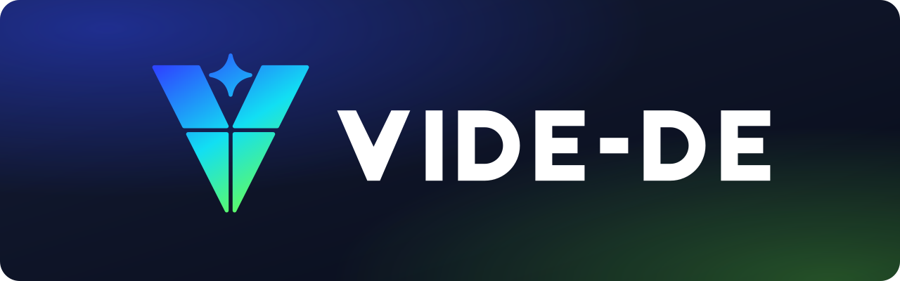

<!-- branding/README.md -->

# VIDE-DE branding

Vector logos, drawn by hand in plain SVG. No fonts, filters or embedded
images, so they render the same in browsers, librsvg and resvg (which the
compositor uses for icons).

<p align="center">
  
</p>

## The idea

- **A V** for VIDE, as before.
- **Four panes** with a cross-shaped gap: the Windoze 10 logo, since the
  desktop is a Windoze 10 copy.
- **A spark** rising out of the V: the usual sign for "an AI made this".
- **Blue to cyan to green**, the gradient of the original logo.

## Files

| File | Use it for |
|---|---|
| `vide-mark.svg` | The logo. Transparent, works on light and dark |
| `vide-mark-white.svg` | One colour, on dark or busy backgrounds |
| `vide-mark-black.svg` | One colour, on light backgrounds and print |
| `vide-glyph.svg` | Tiny sizes (16 to 24 px): no spark, wider gaps |
| `vide-icon.svg` | App icon: the mark on a dark rounded tile |
| `vide-wordmark.svg` | The name alone, dark ink |
| `vide-wordmark-white.svg` | The name alone, white |
| `vide-lockup.svg` | Mark + name, for light backgrounds |
| `vide-lockup-white.svg` | Mark + name, for dark backgrounds |
| `vide-banner.svg` | 1280×400 header for READMEs and link previews |

## Colours

| Name | Hex | Where |
|---|---|---|
| Blue | `#2D46FF` | Gradient start (top left) |
| Cyan | `#12DFF3` | Gradient middle |
| Green | `#6BFF4D` | Gradient end (bottom tip) |
| Ink | `#0B1020` | Dark text, dark tile |
| Paper | `#FFFFFF` | Light text |

## Rules of thumb

- Keep clear space around the mark of at least one pane gap times four.
- Below 32 px use `vide-glyph.svg`; the spark turns to mush.
- Don't recolour the gradient, stretch the mark, or add shadows.

## PNGs

The shell still ships `assets/logo-512.png`. To rasterise one of these:

```bash
rsvg-convert -w 512 branding/vide-icon.svg -o vide-icon-512.png
```
